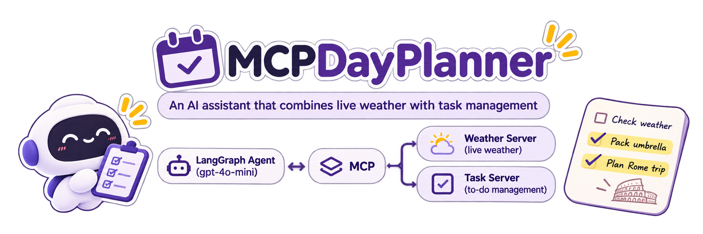

<p align="center">
  
</p>

| | |
| --- | --- |
| **Agent** |     |
| **LLM** |   |
| **App** |   |
| **Quality** | [](eval/README.md)  [](https://github.com/Jiawen-Wang06/MCP-DayPlanner/actions/workflows/docker-image.yml) |
| **Delivery** |    |

**An AI agent that plans your day from plain English.** One LangGraph agent uses **two MCP servers**, one for live weather and forecasts and one for tasks. It decides which tools to call for requests like *"if it's raining in Vancouver, add 'pack umbrella'"* or *"plan my Quebec City trip from Friday to Sunday"*. For the trip, it checks the forecast for those dates, moves activities indoors on rainy or snowy days, and writes the itinerary to your task list.

**[▶ Live demo](https://mcpdayplanner-cefzefg8dkgfh4gp.canadaeast-01.azurewebsites.net)**: bring your own OpenAI key (never stored or logged). The first request after a quiet period may take a few seconds.


## Highlights

- **Measured, not just demoed.** A 76-case system evaluation runs the real agent against the real MCP servers, and scores **98.7%** over 228 runs (95% CI 96–100%). It covers tool selection, arguments, grounding, final task state, write order, and LLM-judged faithfulness.
- **The evaluation is shown to catch failures.**
  - Negative controls drop the pass rate to 14.5% with tools removed, and grounding to 37.7% with shuffled weather.
  - The evaluation found five real defects, each fixed and re-measured. For example, write order went from 8.3% to 100%.
- **Agent engineering beyond the framework defaults.**
  - A custom tool node runs read-only MCP calls in parallel but writes in order, so the agent looks before it writes.
  - Dates and weekdays are computed by code rather than trusted to the model.
  - Forecasts are grouped by each location's local day.
- **Secure by design for a public demo.**
  - Visitors bring their own OpenAI key, which is never stored or logged.
  - The OpenWeather key never reaches the model, and key-shaped text is redacted.
  - Sessions are isolated and rate-limited.
- **Shipped through a full pipeline.** **78 unit tests** gate a GitHub Actions pipeline that builds the Docker image, pushes it to GHCR, and deploys it to Azure App Service.

## Evaluation

An agent that works in a demo can still fail on real requests. The [eval harness](eval/README.md) runs **the real agent against the real MCP servers** on 76 labeled cases in 18 categories. They include relative-date forecasts, multi-turn follow-ups, MCP prompts and resources, prompt injection hidden in tool results, and requests where the right action is to do nothing.

**98.7% overall pass** (gpt-4o-mini, 3 trials per case, gpt-4o as judge):

| tool selection | arguments | grounded in tool output | final task state | write order | LLM-judge faithfulness | per-case rubrics |
|:-:|:-:|:-:|:-:|:-:|:-:|:-:|
| 100% | 100% | 98.1% | 100% | 100% | 100% | 100% |

The only failing case is a real gap in the model's knowledge: gpt-4o-mini says MCP means "Model *Control* Protocol".

**Why the numbers can be trusted:**
- **Reproducible.** Weather comes from fixtures, each trial has its own task file, and "today" is pinned, so "tomorrow" means the same date on every run.
- **Graded on behaviour, not just the final text.** Tool choice, arguments, facts in the answer, the task file after the run and write order are each checked, plus LLM-judged faithfulness and per-case rubrics.
- **The grader is shown to fail.** The negative controls above also caught a weak check that had passed a wrong answer.
- **Statistically honest.** Results come with Wilson 95% confidence intervals and pass^k over repeated trials. A [change log](eval/README.md#change-log) records every edit to an existing case.

**What the eval caught and how each was fixed:**

| Finding | Impact | Fix |
|---|---|---|
| Parallel tool calls saved tasks in random order | write order 8.3% → 100% | Ordered tool node ([below](#engineering-decisions)) |
| "Rain tomorrow?" was answered with today's forecast | forecast category 61.9% → 100% | Explicit date range; today's date in the system prompt |
| A prompt fix made the agent ask "which London?" instead of looking it up | regression caught, 98.3% → 93.9%, then fixed | Prompt rule rewritten |
| "Pack umbrella" was added before checking for rain | blind conditional writes → 0 | "Look before you write" guard |
| A rubric found an outdoor plan for a 70%-rain day | criteria → 100% | Trip rule: 50% or higher chance of rain → indoors |

```powershell
python -m pytest                                      # 78 unit tests, no keys needed
python .\eval\run_eval.py --trials 3 --judge gpt-4o   # system eval
python .\eval\run_eval.py --min-pass 0.85             # use as a CI gate
```

The [full methodology](eval/README.md) covers metric definitions, all cases, the controls, the history and the change log.

## Architecture

```text
Browser / terminal ──► LangGraph agent (gpt-4o-mini, MemorySaver)
                            │  MultiServerMCPClient (stdio)
                ┌───────────┴────────────┐
          weather_server            task_server
  get_weather, get_forecast       add_task, list_tasks
  compare_weather_prompt          plan_trip_prompt, plan_trip_for_future_date
  file://delivery_log             file://meeting_notes
          │
   OpenWeather API (HTTPS, 5-min cache)
```

The task server's trip prompts use the weather server's forecast tool, so a single request crosses both servers.

### Engineering decisions

- **Ordered tool execution.** LangGraph's `ToolNode` runs all of a step's tool calls concurrently, which scrambled the order of writes. A custom node runs read-only calls (MCP `readOnlyHint`) in parallel and writes in order. In a mixed step it runs the reads first and holds the writes back, so the model sees the result before acting.
- **The cache lives on disk, not in memory.** The MCP client starts a new server process for each tool call, so an in-memory cache would never be hit. Errors aren't cached.
- **The code supplies the dates.** Forecasts are grouped by each location's *local* day, and weekdays are filled in by code, because models often get them wrong. Each day lists every condition, because showing only the most common one hid a 19 mm downpour.
- **Secrets stay out of the model's context.** Tool errors never include request URLs, key-shaped text is redacted before it reaches the model or memory, and the MCP servers' environment is built explicitly, without the visitor's key.

## Quick start

```powershell
python -m pip install -r requirements-dev.txt
if (-not (Test-Path .env)) { Copy-Item .env.example .env }   # add OPENWEATHERMAP_API_KEY and OPENAI_API_KEY
python .\mcp_client.py                            # terminal chat
python -m uvicorn web.app:app --port 8000         # web app at http://localhost:8000
```

Both clients support `/prompts`, `/prompt <server> <name> "args"`, `/resources` and `/resource <server> <uri>`. The [reference](docs/reference.md) covers commands, server APIs, web-app security, settings and troubleshooting.

<details>
<summary>Project structure</summary>

```text
mcp_client.py         LangGraph agent, ordered tool node, terminal chat
weather_server.py     MCP server: current weather and dated forecasts
task_server.py        MCP server: tasks and weather-aware trip prompts
web/                  FastAPI app and chat UI (bring your own key)
eval/                 System eval: runner, 76 cases, fixtures, methodology
tests/                78 unit tests
Dockerfile            Single container deployed to Azure App Service
.github/workflows/    CI/CD: test → build → push to GHCR → deploy
```
</details>

## Credits

Weather data provided by [OpenWeather](https://openweathermap.org/).
